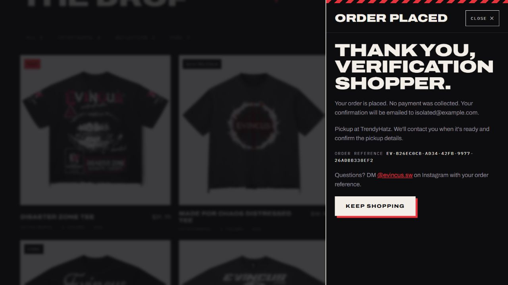

# Security and optimization implementation report

October 18, 2026. Changes are local and have not been deployed. See the [48-item checklist](security-and-optimization-checklist.md) for completed and outstanding work and the [operations guide](security-operations.md) for execution procedures.

## Implemented

Request streaming limits, HTTP/provider/browser deadlines, quote/admin/link abuse controls, validated Render-specific IP handling, security headers, production configuration guards, an unprivileged container definition, test-email guards, stronger redaction, and safer HTML/image handling.

Performance and reliability changes include conditional static responses, a bounded cache, gzip/Brotli, concurrent startup, graceful shutdown, responsive photo assets, image geometry/priority, a WOFF2 display font, paginated newsletter storage, consent rechecks, stable retries, and concurrent signup protection. Repeatable security/performance/load/restore checks, expanded release gates, monthly review workflows, and the operations guide support ongoing work.

## Local evidence

| Check | Result |
| --- | --- |
| Full regression suite | **230 passed, 0 failed, 0 skipped**, including real KV and HTTP restart/replay |
| npm advisory audit | **0 known vulnerabilities** after querying the registry |
| Working files/fetched history | No matching private paths or high-confidence credential patterns across 88 commits; not a universal secret detector |
| Static budgets | Pass: manifest 2,935 bytes gzip, CSS 9,828, homepage 4,823 at measurement |
| Responsive photos | 70 originals → 203 variants; smallest variants 1,486,778 versus 9,357,291 bytes, **84% smaller**; each variant ≤ 250 KiB |
| Display font | 922,676 → 28,848 bytes, **about 97% smaller** |
| HTTP behavior | Streaming/declared 413 responses, compression, HEAD/304, private-file rejection, health, shutdown, persisted checkout replay pass |
| Local load | 110 requests, concurrency 10, zero failures, **76 ms p95**; five duplicate submissions, one order — [raw result](security-evidence/load-report.json) |
| Synthetic restore | Logical values match the snapshot, including chunked records — [raw result](security-evidence/restore-report.json); not a production snapshot |
| Browser | Homepage, product/gallery/size, bag quote, pickup checkout/confirmation, and eras; **no console warnings/errors**, CSP enforced, disposable KV, email disabled |
| Formatting | `git diff --check` passes |

Existing in-memory `@deno/kv` tests emit a Node long-TTL timer warning while passing. Persistent SQLite restart checks pass separately. Docker is unavailable on this workstation, so image execution, actual mounted-disk ownership, and container vulnerability results are deferred to the configured CI checks.

The screenshot contains synthetic test information. No payment or real email was sent.

## Remaining external steps

Render and GitHub access is needed to publish/run the prepared checks, verify live settings and ingress, inspect/rotate secrets, configure branch protections, and confirm backups/disk behavior. Production CSP needs report-only rollout followed by enforcement. Resend needs a controlled test inbox; external monitoring needs its account and a notification test. MFA and registrar access reviews require their account owners.

The owner said fulfillment details remain unconfirmed. Delivery price, country exclusions, and the two pickup street addresses were therefore left unchanged and remain release blockers.

A recent production snapshot has not been supplied. Synthetic restoration proves the tooling, not production recovery objectives. Mobile slow-network profiling and mobile/desktop field Web Vitals remain unmeasured. Recurring reviews remain ongoing obligations after publication.

No deployment, production credential rotation, live order creation, real email delivery, or account-access changes were performed.
